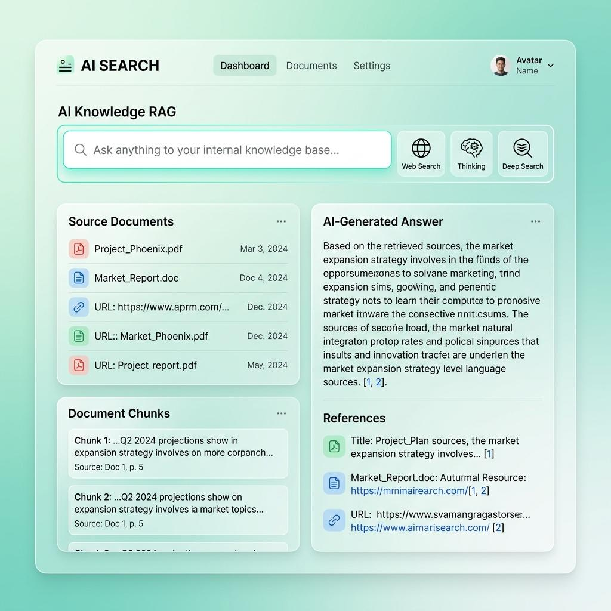

# Enterprise Knowledge Base RAG Assistant



Internal assistant that answers questions from company documents and shows citations. The screen to match is `apps/web/UI.jpeg`.

The API follows `apps/api/NESTJS-STRUCTURE.md` (JavaScript, Babel, one action per service). The schedule is `docs/30-day-plan.md`. Read the "Before Day 1" section in that file before writing feature code.

## Layout

- `apps/api` — NestJS API. HTTP entry `index.js`, cron `cron.index.js`, queue worker `queue.index.js`
- `apps/web` — React + TypeScript UI (Vite)
- `docs/30-day-plan.md` — daily work for 30 days
- `docs/architecture.md` — product and data flow

## Run the apps

Requires Node.js 20+.

```bash
cd apps/api
npm install
npm run dev
```

Health: http://localhost:6000/api/health

```bash
cd apps/web
npm install
npm run dev
```

Web: http://localhost:5173 (proxies `/api` to the API)

The dashboard opens with sample rows so the layout is visible. Later days in the plan replace those rows with the API.

Queue and cron processes (they boot, and do no work yet):

```bash
cd apps/api
npm run queue-dev
npm run cron-dev
```

## Local data services

MySQL 9 and Redis are for the database days in the plan. They are not required to open the starter UI. MySQL 9 stores embeddings in a `VECTOR` column and ranks them with `DISTANCE`.

```bash
docker compose up -d
```

Copy `.env.example` to `.env` when you reach those days. `.env.example` has placeholders only.

| Service | URL | Credentials |
|---|---|---|
| MySQL 9 | `localhost:3306` | user `rag`, password `rag`, database `rag` |
| Redis | `localhost:6379` | none |
