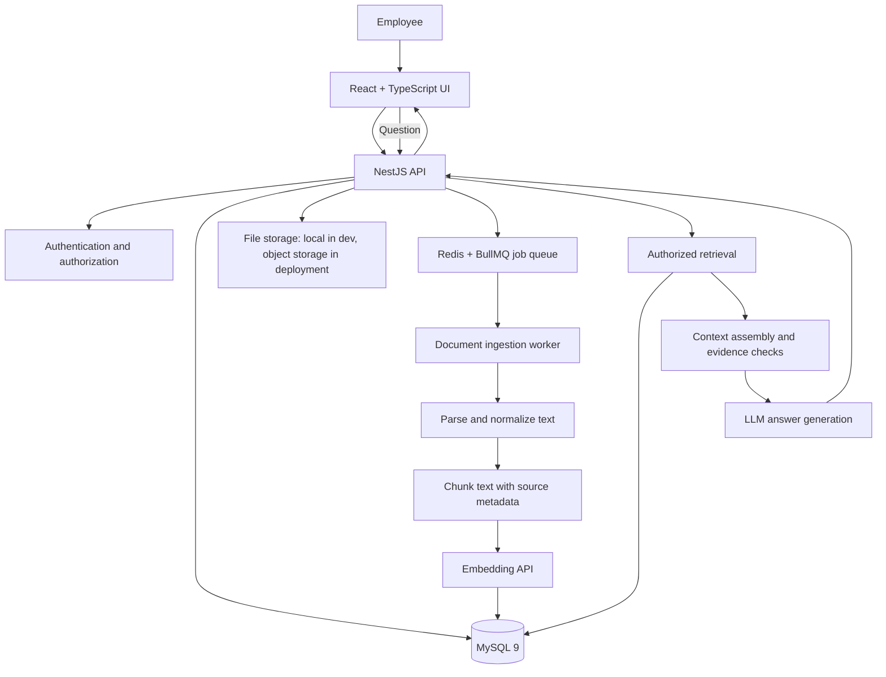

# Project 1: Enterprise Knowledge Base RAG Assistant

> **Status:** Planning  
> **Goal:** Build, test, deploy, and confidently explain an end-to-end RAG application.  
> **Primary stack:** React + TypeScript, NestJS, MySQL 9, Redis + BullMQ, an LLM/embedding API.  
> **Build principle:** Start with a small working vertical slice, then add reliability and production features in phases. Do not claim performance results until measured.

## 1. Product definition

Build an internal knowledge assistant that lets an authenticated employee upload approved company documents and ask questions about them. Answers must be grounded in retrieved document passages and show citations that take the user back to the source. If the indexed documents do not contain enough evidence, the system should say so rather than invent an answer.

### Example user story

An employee uploads an internal payment-reconciliation policy and asks: “What should I do when a payment reconciliation job fails?” The application searches only documents the employee is allowed to access, retrieves relevant passages, generates a concise answer, and shows the source document and page/section references.

### In scope

- Upload PDF, DOCX, TXT, and Markdown files.
- Extract text and useful source metadata.
- Split extracted text into chunks while retaining page/section references.
- Generate embeddings and store them in MySQL 9 `VECTOR` columns.
- Retrieve relevant chunks and generate grounded answers with citations.
- Show ingestion status, document status, and source passages in the UI.
- Support document replacement, reprocessing, and deletion.
- Add authentication and document-level authorization.
- Add automated tests, retrieval/answer evaluation, logging, and deployment documentation.

### Not in the first version

- Multi-agent workflows, fine-tuning, knowledge graphs, voice, and autonomous actions.
- Complex multi-tenant enterprise administration.
- Reranking before a baseline retrieval system has been measured.
- Supporting every possible file type. Add formats only when there is a clear need.

## 2. Architecture at a glance



### Component responsibilities

| Component | Responsibility | Why it exists |
|---|---|---|
| React + TypeScript | Upload documents, show processing status, submit questions, display answers and citations | User-facing workflow |
| NestJS API | Validate requests, enforce permissions, coordinate services, return typed responses | A clear application boundary |
| MySQL 9 | Store users, documents, ingestion state, chunks, conversations if needed, and audit metadata | Durable relational data |
| MySQL `VECTOR` | Store and search chunk embeddings with `DISTANCE` | Similarity search in the same database as the documents |
| Redis + BullMQ | Queue long-running ingestion jobs, retry transient failures, track job state | Upload requests should not wait for parsing and embedding to finish |
| Ingestion worker | Parse, chunk, embed, and index a document | Separates slow background work from API request handling |
| File storage | Preserve the original uploaded file | Allows reprocessing and source access |
| Embedding model | Convert text and questions into vectors in the same embedding space | Enables semantic similarity search |
| LLM | Compose an answer from retrieved evidence | Converts selected evidence into a useful response |

**Important distinction:** the LLM does not search the database by itself. The application retrieves authorized evidence first, then supplies that evidence to the LLM. The LLM should not be treated as the source of truth.

## 3. Two end-to-end flows

### A. Document ingestion flow

1. The user signs in and uploads a supported file.
2. The API validates file type, size, ownership/access scope, and request fields.
3. The API creates a document record with status `queued` and stores the original file.
4. The API enqueues an ingestion job and returns a document ID plus status. It does not wait for the whole pipeline.
5. The worker loads the file and extracts text. It records page numbers or section headings when the parser exposes them.
6. The worker normalizes text conservatively, preserving meaningful headings, lists, tables, and page boundaries where possible.
7. The worker splits text into overlapping chunks. Every chunk keeps document ID, chunk index, page/section, tenant or access scope, and version metadata.
8. The worker requests embeddings for the chunks in batches, respecting provider limits and retry rules.
9. The worker stores chunk text, metadata, and embedding vectors in MySQL, then marks the document `ready` only after indexing succeeds.
10. The UI polls or receives status updates and lets the user know whether processing succeeded or failed.

**Failure behavior:** use bounded retries for transient failures, record a useful error state, avoid duplicate chunks when a job is retried, and make reprocessing safe. Never show a document as ready before its index is usable.

### B. Question-answering flow

1. The user submits a question from the UI.
2. The API authenticates the user and validates the question and requested scope.
3. The API embeds the question using the compatible embedding model.
4. The retrieval layer searches only chunks the user is authorized to access. Start with vector similarity and a configurable top-k.
5. The application optionally applies metadata filters and later compares keyword/hybrid retrieval against the baseline.
6. The application checks whether the retrieved evidence is relevant enough, assembles a bounded context, and retains the source metadata for each passage.
7. The LLM receives the question, retrieved passages, and instructions to answer only from evidence, cite supplied sources, and state when evidence is insufficient.
8. The API validates the answer structure and citation IDs. A citation must refer to a chunk actually retrieved for this answer.
9. The API returns the answer, citations, and useful metadata such as request ID and latency.
10. The UI renders the answer and clickable citations with document name and page/section where available.

**Security rule:** authorization must be enforced in the database retrieval query or a trusted retrieval layer—not only in the prompt. Retrieved document text is untrusted data and may contain prompt injection; it must never override system instructions or grant access.

## 4. Suggested data model

Keep the schema small at first; evolve it when requirements justify it.

### `users`

- `id` (UUID, primary key)
- `email` (unique)
- `password_hash` or external identity-provider subject
- `created_at`, `updated_at`

### `documents`

- `id` (UUID, primary key)
- `owner_id` (user or organization reference)
- `title`, `original_filename`, `mime_type`, `file_size_bytes`
- `storage_key` (never rely on the original filename as a path)
- `content_hash` (for duplicate detection)
- `status` (`queued`, `processing`, `ready`, `failed`, `deleting`, `deleted`)
- `version` or `source_version`
- `error_code` / safe error summary
- `created_at`, `updated_at`, `processed_at`

### `document_chunks`

- `id` (UUID, primary key)
- `document_id` (foreign key)
- `chunk_index`
- `content` (chunk text)
- `embedding` (MySQL 9 `VECTOR` column using the selected model's vector dimension)
- `page_number` (nullable), `section_title` (nullable)
- `metadata` (JSONB for carefully chosen extensible metadata)
- `created_at`
- Unique constraint on `(document_id, chunk_index, source_version)` or an equivalent version-aware key.

### Optional later tables

- `organizations`, `memberships`, `document_permissions` for shared workspaces and fine-grained access.
- `conversations`, `messages`, `answer_citations` if chat history is required.
- `ingestion_jobs` only if BullMQ job data plus document status is insufficient for product-level audit needs.
- `audit_events` for document access, permission changes, deletion, and administrative actions.

**Schema decisions to explain:** why document records and chunk records are separate; why source metadata is stored with each chunk; how replacement/deletion affects chunks; how access scope is represented; and how duplicate processing is prevented.

## 5. API design (initial proposal)

Use consistent DTO validation and a common error format. Exact routes can change as implementation progresses.

| Method and route | Purpose | Notes |
|---|---|---|
| `POST /api/documents` | Upload a document | Auth required; validate size/type; return `202 Accepted` or equivalent queued response |
| `GET /api/documents` | List accessible documents | Pagination and status filters |
| `GET /api/documents/:id` | Get document status and metadata | Enforce access check |
| `POST /api/documents/:id/reprocess` | Re-run ingestion | Idempotent job behavior; authorized users only |
| `DELETE /api/documents/:id` | Delete document and its index | Define safe deletion and cleanup behavior |
| `POST /api/qa` | Ask a question | Auth required; return answer and validated citations |
| `GET /api/health` | Liveness/health check | Avoid exposing secrets or sensitive infrastructure details |

Example QA response shape:

```json
{
  "answer": "Follow the recovery steps described in the payment policy...",
  "insufficientEvidence": false,
  "citations": [
    {
      "documentId": "document-uuid",
      "documentTitle": "Payment Reconciliation Policy",
      "chunkId": "chunk-uuid",
      "pageNumber": 4,
      "quote": "Relevant supporting passage..."
    }
  ],
  "requestId": "request-uuid"
}
```

This is an illustrative contract, not a promise that the exact IDs or page numbers will exist for every file. Citation metadata must come from stored source records, not be invented by the model.

## 6. Repository structure

A practical monorepo keeps the frontend, API, and worker close together while allowing clear boundaries.

```text
enterprise-rag-assistant/
├── apps/
│   ├── web/                  # React + TypeScript UI
│   ├── api/                  # NestJS HTTP API
│   └── worker/               # BullMQ ingestion worker (can start inside API app)
├── packages/
│   └── shared/               # Shared DTOs/types only when useful
├── docs/
│   ├── architecture.md       # This blueprint
│   ├── decisions/             # Architecture decision records (ADRs)
│   └── evaluation.md
├── evals/
│   ├── questions.jsonl        # Questions and expected source documents/chunks
│   └── README.md
├── infra/                     # Docker Compose and deployment configuration
├── .env.example               # Variable names only; never real secrets
├── .gitignore
└── README.md
```

Do not create abstractions merely to make the repository look enterprise-grade. If the worker initially lives in the NestJS application, document the boundary and split deployment only when operationally useful.

## 7. Implementation phases

Complete each phase with a working demo, tests, and a short explanation in your own words. Avoid implementing all features at once.

### Phase 0 — Scope, setup, and baseline

**Build**
- Write the product scope and non-goals.
- Create the repository, README, environment template, formatting/linting, and test setup.
- Start MySQL 9 and Redis locally, preferably with Docker Compose. Use MySQL 9, not MySQL 8, because the `VECTOR` type is required.
- Choose one LLM provider and one embedding model; record model names and configuration.
- Decide initial chunk size/overlap through experiments rather than treating one value as universally correct.

**Learn and explain**
- What RAG is and why a normal LLM call is not document-grounded.
- Embeddings, vector similarity, chunking, context window, and hallucination.
- Why an embedding model change can require re-embedding existing chunks.

**Done when**
- A new developer can follow the README to start the dependencies and run tests.
- Secrets are excluded from Git and `.env.example` contains placeholders only.

### Phase 1 — Minimum working RAG vertical slice

**Build**
- Add a simple upload path for one or two supported formats.
- Parse text, chunk it, create embeddings, and save chunks plus metadata.
- Implement question embedding and vector similarity retrieval.
- Pass retrieved passages to the LLM and return an answer with source metadata.
- Build a minimal UI to upload a file and ask a question.

**Keep it deliberately simple**
- Process synchronously at first if that helps you understand the pipeline, while enforcing upload and request limits. Move long-running ingestion to a queue in Phase 3.
- Start with a small known document set and a single-user/local development environment.
- Do not claim that the answer is reliable merely because it sounds plausible.

**Done when**
- You can trace one question from UI → API → embedding → retrieval → LLM → cited answer.
- You can explain where every retrieved passage came from.
- At least one automated integration test covers a question with a known answer/source.

### Phase 2 — Grounding, citations, and retrieval evaluation

**Build**
- Add page/section metadata where parsers make it available.
- Return citations linked to actual retrieved chunk IDs; reject or remove unknown citation IDs.
- Add a clear insufficient-evidence response and test it.
- Create a version-controlled evaluation set with realistic questions, expected source documents, and unanswerable questions.
- Measure retrieval quality with Hit Rate@k or Recall@k and manually review answer faithfulness/citation correctness.
- Add metadata filters and compare them with the baseline.

**Done when**
- Evaluation can be run repeatedly and produces comparable results.
- You can show examples of successful retrieval, missed retrieval, unsupported questions, and citation validation.
- You have recorded a baseline before adding retrieval complexity.

### Phase 3 — Production-minded ingestion and document lifecycle

**Build**
- Move ingestion to Redis + BullMQ background jobs.
- Add statuses, retry/backoff for transient errors, timeouts, and a failed-job path.
- Make ingestion idempotent so retrying a job does not create duplicate chunks.
- Add file size/type validation, content hashing, duplicate detection, and safe parser error handling.
- Support document reprocessing/replacement and deletion, including vector/chunk cleanup and original-file cleanup.
- Add job progress/status to the UI.

**Done when**
- Upload returns quickly while processing continues in the background.
- A simulated provider failure can retry and eventually succeed or fail visibly.
- Reprocessing and deletion leave no stale searchable chunks.

### Phase 4 — Authentication, authorization, and security

**Build**
- Add authentication appropriate for the demo/deployment.
- Add ownership or organization-based document permissions.
- Apply authorization to document listing, status, download, reprocess, delete, and retrieval queries.
- Validate inputs and outputs; rate-limit expensive endpoints; cap file size, page count, chunk count, and question length.
- Protect secrets, avoid logging raw sensitive document text, and add safe error messages.
- Treat retrieved text as untrusted; test prompt-injection attempts inside documents.
- Add audit events for important access and lifecycle operations where appropriate.

**Done when**
- A user cannot retrieve another user's document chunks by changing an ID or manipulating a filter.
- Automated tests cover cross-user access denial.
- A malicious instruction inside a document cannot override system behavior or bypass permissions.

### Phase 5 — Retrieval improvements and performance

**Build in measured increments**
1. Establish a vector-search baseline.
2. Add MySQL `FULLTEXT` keyword retrieval and implement hybrid ranking or fusion.
3. Compare retrieval metrics on the same evaluation set.
4. Test a reranker only if the evaluation shows a meaningful problem it may solve.
5. Tune indexes, database queries, embedding batch sizes, and context limits.
6. Record end-to-end latency, retrieval latency, token usage, and approximate cost per question.

**Done when**
- You can explain why you kept or rejected each added technique using evaluation results.
- Performance claims have reproducible measurements, a defined dataset, and a stated test environment.

### Phase 6 — Deployment, observability, and portfolio polish

**Build**
- Deploy the frontend, API, worker, MySQL 9, Redis, and file storage using an appropriate hosting setup.
- Configure health checks, structured logs, request IDs, ingestion failure monitoring, and safe operational alerts.
- Add database migrations, backup/restore notes, and deployment instructions.
- Write architecture and data-flow documentation, an API overview, limitations, and troubleshooting notes.
- Record a short demo showing upload, processing, a cited answer, an unanswerable question, and deletion.

**Done when**
- Another engineer can run or deploy the project from the documentation.
- The deployed demo has no secrets in the repository and does not expose private documents.
- The README contains only measured results and clearly states remaining limitations.

## 8. Testing strategy

- **Unit tests:** text normalization, chunk boundaries, metadata mapping, citation validation, permission predicates, and status transitions.
- **Integration tests:** database persistence, MySQL vector retrieval, job retries, idempotent ingestion, deletion cleanup, and provider adapters with mocks where appropriate.
- **End-to-end tests:** upload → processing → question → answer/citations; insufficient evidence; unauthorized access; deletion.
- **Evaluation tests:** known questions, paraphrased questions, questions requiring multiple chunks, irrelevant questions, and questions with no answer in the corpus.
- **Security tests:** oversized files, unsupported types, malicious document instructions, path/filename abuse, IDOR/cross-user access, and rate limits.

LLM outputs can vary. Keep deterministic assertions around schema, permissions, source IDs, and pipeline behavior; evaluate semantic answer quality using a rubric and representative examples instead of relying only on exact-string assertions.

## 9. Evaluation and metrics

Track a small set of metrics and explain what each means.

| Metric | What it tells you | How to measure |
|---|---|---|
| Hit Rate@k / Recall@k | Whether expected evidence appears in the top-k retrieved chunks | Compare retrieval output with labeled expected sources |
| Citation validity | Whether each citation points to a real retrieved source | Validate IDs and metadata in code |
| Faithfulness / groundedness | Whether claims in the answer are supported by the retrieved evidence | Human review rubric; optional model-assisted scoring with spot checks |
| Abstention quality | Whether the system avoids unsupported answers without refusing answerable ones | Include answerable and unanswerable evaluation questions |
| Ingestion success rate | How often valid documents finish indexing successfully | Successful jobs / valid submitted jobs over a defined period |
| Latency | Time spent in ingestion, retrieval, LLM generation, and end-to-end | Request/job timing instrumentation; report percentiles when sample size permits |
| Cost per question | Approximate embedding and generation cost per request | Token/API usage and the selected provider's current pricing |

Do not invent targets or resume numbers. First collect a baseline, then define a target that fits your use case and dataset.

## 10. Important engineering decisions to document

Create short Architecture Decision Records (ADRs) as you make meaningful choices. Each ADR should contain: context, options considered, decision, trade-offs, and what would make you revisit it.

- Why MySQL `VECTOR` instead of a separate vector database for this version?
- Why use a background queue for ingestion, and what belongs in a job payload?
- How were chunk size and overlap selected and evaluated?
- How are page numbers and source links preserved across parsing and chunking?
- How are permissions enforced during retrieval?
- How do document replacement and deletion avoid stale chunks?
- What does “insufficient evidence” mean in this implementation?
- When is hybrid search or reranking worth the extra complexity?
- How are embedding-model changes/versioning handled?
- What sensitive information is excluded from logs?

## 11. Interview explanation framework

Practice explaining the project in this order:

1. **Problem:** employees need trustworthy answers across internal documents and must verify the source.
2. **Architecture:** React UI, NestJS API, MySQL 9, Redis/BullMQ worker, embedding model, and LLM.
3. **Ingestion:** upload → parse → normalize → chunk → embed → index.
4. **Question flow:** authorize → embed question → retrieve evidence → check evidence → generate → validate citations → return response.
5. **Reliability:** retries, idempotency, status tracking, document versioning, and cleanup.
6. **Security:** access control in retrieval, input limits, secret handling, and prompt-injection defenses.
7. **Evaluation:** labeled test set, retrieval metrics, answer/citation review, latency, and cost.
8. **Trade-offs:** what you deliberately kept simple, what you measured, and what you would improve next.

### Questions you should be able to answer

- Why does RAG help, and what does it not solve?
- Why chunk documents? What can go wrong with chunks that are too small or too large?
- What is an embedding, and why must query and document embeddings be compatible?
- How does vector similarity search work at a high level?
- How do you prove a citation is real rather than model-invented?
- How does the system handle a document that is uploaded twice or reprocessed after a failure?
- How do you prevent one user from retrieving another user's chunks?
- What happens if the embedding or LLM provider is down or rate-limits you?
- How do you evaluate retrieval separately from answer generation?
- When would you add hybrid search or reranking?
- How would you re-index documents after changing the embedding model?
- What are the biggest latency, cost, security, and quality trade-offs?

## 12. Resume evidence checklist

Only add claims after you have implemented and verified them.

- [ ] Public or safely demoable repository with setup instructions.
- [ ] Architecture diagram and ingestion/question flow.
- [ ] Supported formats and document limits documented.
- [ ] Citation behavior tested against retrieved chunk IDs.
- [ ] Evaluation dataset and reproducible metrics committed.
- [ ] Ingestion retry/idempotency and document deletion tested.
- [ ] Authorization tests demonstrate cross-user isolation.
- [ ] Deployed demo or recorded walkthrough.
- [ ] Actual latency/cost/quality measurements with test conditions.

### Resume bullet template (fill in only after measurement)

> Built an enterprise knowledge-base RAG assistant using React, TypeScript, NestJS, MySQL, and Redis/BullMQ, implementing document ingestion, citation-backed semantic/hybrid retrieval, access controls, and repeatable retrieval evaluation; measured **[verified metric]** on **[dataset/test conditions]**.

## 13. First seven work sessions

Use these as focused sessions, not fixed calendar deadlines. Finish a session's deliverable before expanding scope.

1. **Session 1:** Create repository, README, this architecture document, and a short list of supported file types and non-goals.
2. **Session 2:** Run MySQL 9 and Redis locally; create the first database migration and verify connectivity.
3. **Session 3:** Build a script that reads one sample document and prints extracted text with page/section metadata.
4. **Session 4:** Implement chunking; inspect chunk boundaries manually and preserve source metadata.
5. **Session 5:** Generate embeddings and persist chunks; write a query that returns the top-k relevant chunks.
6. **Session 6:** Implement one question endpoint that passes retrieved evidence to the LLM and returns validated citations.
7. **Session 7:** Build a minimal UI and demonstrate one complete upload-to-answer flow; write down bugs and unknowns before starting the next phase.

## 14. Definition of done for the whole project

The project is complete enough for a strong portfolio when a reviewer can run it, upload a document, ask a question, inspect valid source citations, see an appropriate refusal for unsupported questions, understand the architecture from the documentation, and review real evaluation/security test results. “Complete” does not mean implementing every possible RAG technique; it means building a coherent system and being able to defend its design choices with evidence.
